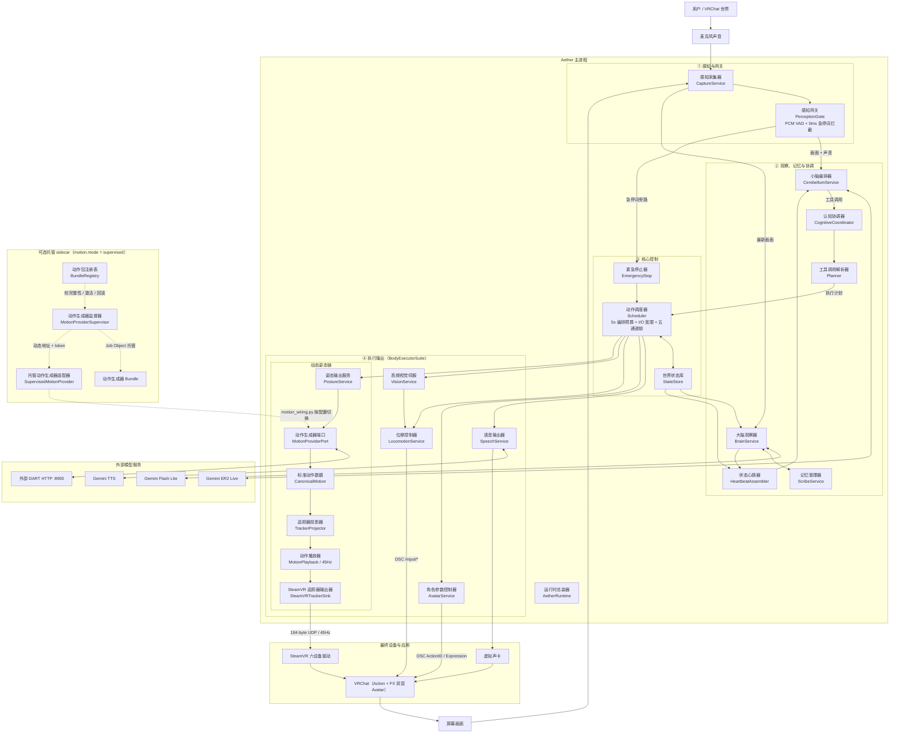

# Aether VR

**VRChat 虚拟角色系统**：大脑负责观察与人格，小脑负责理解与编排，核心控制层负责双预算与五通道安全调度，输出层负责把动作、语音和移动送入 VRChat。

---

## 架构

主图按当前运行路径绘制。**实线**表示默认运行路径（`motion.mode: "external"`）；**虚线**表示通过 `motion.mode: "supervised"` 即可切换启用的受管 sidecar 控制面。



### 统一模块命名

显示名称统一采用“**中文职责名（English Code Name）**”格式。

| 中文职责名（English Code Name） | 主要职责 |
|---|---|
| 运行时总装器（`AetherRuntime`） | 组合根：装配核心与服务、连接四大运行期协作者、统一管理启动与停机 |
| 身体执行器套件（`BodyExecutorSuite`） | 调度器到各输出服务的唯一接缝；管理全身姿态冻结/恢复、动态生成超时回退与受锁视觉逼近 |
| 感知网关（`PerceptionGate`） | 音视频泵、PCM16 RMS 轻量 VAD（`user_speaking` 尾音保持）与转写 0ms 急停词拦截 |
| 认知协调器（`CognitiveCoordinator`） | 大脑启动热观察 + 用户发言防抖唤醒、0.5s 心跳循环、建议台词快照锁定与工具响应回传 |
| 动作接线器（`motion_wiring`） | 按 `config.motion.mode` 构建外部 HTTP 或受管 sidecar `MotionProviderPort`，并计算 I/O 宽限 |
| 感知采集器（`CaptureService`） | 采集屏幕画面和麦克风音频，支持等待新帧（`fresh_frame`） |
| 大脑观察器（`BrainService`） | 观察环境、加载外置 YAML 人格、生成建议台词与记忆候选（含配额冷却） |
| 记忆管理器（`ScribeService`） | 最新优先上下文渲染、锁外批量重要性裁决、异步线程化 SQLite 持久化与召回 |
| 小脑编排器（`CerebellumService`） | 维护 ER2 Live 会话，完整下发嵌套工具 Schema 并接收增量/最终转写与工具调用 |
| 动作调度器（`Scheduler`） | 分离 5s 编排动作预算与云端/GPU 合成 I/O 宽限，按顺序与五通道锁执行计划 |
| 世界状态库（`StateStore`） | 保存系统当前权威事实的不可变快照 |
| 紧急停止器（`EmergencyStop`） | 词边界安全匹配 + 并发停止语音、移动、视觉伺服、动作和当前计划 |
| 语音输出器（`SpeechService`） | 合成语音并输出到虚拟声卡；取消时立即调用 `sd.stop()` 杜绝重叠播放 |
| 角色参数控制器（`AvatarService`） | 通过 OSC 控制 VRChat `Action` 层（`ActionID`）与 `FX` 层（`Expression`）参数 |
| 位移控制器（`LocomotionService`） | 通过 OSC `/input/*` 控制角色在世界中的移动（带看门狗归零） |
| 高频视觉伺服（`VisionService`） | OpenCV HOG 人物检测（缺失自动降级）与脉冲式走-看-走逼近 |
| 姿态输出服务（`PostureService`） | 供应商中立门面：协调 `MotionProviderPort`、投影、45Hz 播放与 SteamVR UDP 输出 |

### 三条不可混淆的输出路径

| 要控制的东西 | 路径 | 原因 |
|---|---|---|
| 骨骼级动态姿态 | `PostureService` → SteamVR 六设备桥 → FBT IK | OSC 参数不能传骨骼旋转 |
| 预录动作 / 面部表情 | `AvatarService` → OSC Avatar Parameters（`Action` 层骨骼肌肉 + `FX` 层纯面部 BlendShape） | 严禁把表情与全身骨骼混在同一层，也严禁在 FX 层覆盖 `vrc.v_*` 口型视素 |
| 世界中的位移 | `LocomotionService` / `VisionService` → OSC `/input/*` | DART 走路只是骨架动作，不改变世界坐标 |

---

## 目录结构

```text
aether/
├── contracts/              跨服务数据契约（零下层依赖）
│   ├── motion.py           标准动作、能力与健康状态
│   ├── frame.py            六设备位姿与 184-byte UDP 线格式
│   ├── plan.py             动作计划、通道、步骤与统一步长估算
│   ├── facts.py            世界事实快照与健康状态归一化
│   ├── observation.py      大脑输出（含单调 output_id 唤醒去重标识）
│   ├── perception.py       音视频块
│   └── vision.py           视觉检测与伺服状态契约
├── core/                   纯编排机制与安全控制（仅依赖 contracts）
│   ├── state_store.py      权威事实库
│   ├── facts_renderer.py   事实文本渲染
│   ├── scheduler.py        序号、五通道锁与「编排预算 + I/O 宽限」双预算引擎
│   ├── heartbeat.py        心跳拼装与单次唤醒发送闸门
│   └── safety.py           词边界急停匹配与并发紧急停止
├── services/               领域服务（仅依赖 contracts + infra + ports，服务间互不引用）
│   ├── ports.py            全项目唯一 Port Protocol 定义源
│   ├── motion/             动作生成器、翻译器与 Windows 64-bit Job sidecar 监督器
│   ├── posture/            供应商中立姿态投影、45Hz 播放与 SteamVR 输出
│   ├── capture/            屏幕与麦克风采集
│   ├── vision/             高频人物检测与脉冲逼近伺服
│   ├── brain/              YAML 人格加载、环境观察与配额冷却
│   ├── scribe/             最新优先上下文与异步 SQLite 长期记忆
│   ├── cerebellum/         ER2 Live 会话、递归工具 Schema 与计划解析
│   ├── speech/             TTS 合成、可打断播放与兜底音频
│   ├── avatar/             预录动作与表情 OSC
│   └── locomotion/         移动 OSC 与 watchdog
├── infra/                  Pydantic 配置与彩色日志
└── runtime/                组合根与四大运行期协作者
    ├── agent.py            AetherRuntime 组合根与生命周期
    ├── motion_wiring.py    external / supervised 动作生成器装配与宽限计算
    ├── executors.py        BodyExecutorSuite 身体执行器套件
    ├── perception_gate.py  PerceptionGate 音视频泵 + PCM VAD + 急停拦截
    ├── coordinator.py      CognitiveCoordinator 大脑/心跳/工具协调
    ├── cli.py              交互式控制台
    ├── posture_cli.py      独立姿态调试入口
    ├── smoke.py            无云端核心 + UDP 冒烟检查
    └── vrchat_test.py      真实 VRChat OSC 可见动作验收工具
```

---

## 快速开始

```powershell
# 1. 环境
$env:GEMINI_API_KEY = "your-key"
python -m venv .venv; .\.venv\Scripts\activate
pip install -r requirements.txt

# 2. 本机自动化全检（不依赖云端、WSL、SteamVR 或麦克风）
python scripts/dev_verify.py --smoke

# 3. 准备外部 DART 服务（默认 motion.mode="external" 访问 http://127.0.0.1:8900）
wsl -d Ubuntu -- bash -lc "cd /root/DART && bash start_server.sh"

# 4. 独立调试姿态输出
python -m aether.services.posture --prompt "walk forward" --duration 3

# 5. 启动主运行时
python -m aether
```

CLI 命令：`/status` `/facts` `/say` `/do` `/face` `/move` `/motion` `/approach` `/idle` `/plan` `/stop` `/quit`

### 重新生成 Unity VRChat Avatar 资产

```powershell
Start-Process -Wait -FilePath "C:\Program Files\Unity\Hub\Editor\2022.3.22f1\Editor\Unity.exe" -ArgumentList @(
  "-batchmode", "-quit", "-nographics",
  "-projectPath", '"avatar-project"',
  "-executeMethod", "Aether.AvatarSetup.RegenerateAll"
)
```

---

## 关键约束

- `contracts/frame.py` 的线格式与 `dart-steamvr-bridge/driver/src/driver.cpp` 严格对应（184 字节，magic `0x54524144`）。改动任一侧必须同步另一侧。
- 驱动 1 秒收不到包即把设备标记为 OutOfRange，因此 `posture` 必须常驻 45Hz 推流，静止时也不能停。
- ER2 的工具调用必须 100% 回传 `function_response`，否则会话卡死。
- 台词只出自大脑 `suggested_reply`；ER2 不自行编写人设台词。
- 编排动作时长受 `max_plan_seconds: 5.0` 约束，云端 TTS 与动态动作推理延迟走独立的 `synthesis_allowance_s` 宽限。

---

## 许可

仅供学习研究。DART 模型受其原始许可证约束，Gemini API 使用需遵守 Google 条款。
