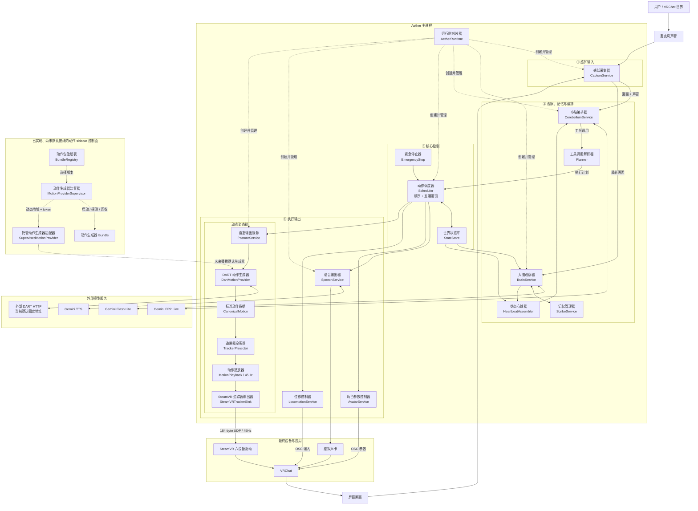

# Aether

**VRChat 虚拟角色系统**：大脑负责观察与人格，小脑负责理解与编排，核心控制层负责安全调度，输出层负责把动作、语音和移动送入 VRChat。

---

## 架构

主图按当前默认运行路径绘制。**实线**表示已经接入 Runtime 的数据流；**虚线**表示已经实现、但尚未接入默认 Runtime 的 sidecar 托管能力。



### 统一模块命名

显示名称统一采用“**中文职责名（English Code Name）**”格式。这里统一的是文档和沟通用名称，Python 类名与文件名保持不变，避免破坏现有接口。

| 中文职责名（English Code Name） | 主要职责 |
|---|---|
| 运行时总装器（AetherRuntime） | 创建模块、连接模块、管理整体启动与停止 |
| 感知采集器（CaptureService） | 采集屏幕画面和麦克风音频 |
| 大脑观察器（BrainService） | 观察环境、维持人格、生成建议台词与记忆候选 |
| 记忆管理器（ScribeService） | 筛选、压缩、保存和召回长期记忆 |
| 小脑编排器（CerebellumService） | 维护 ER2 Live 会话并接收工具调用 |
| 工具调用解析器（Planner） | 把 ER2 工具调用转换成内部执行计划 |
| 状态心跳器（HeartbeatAssembler） | 把事实状态和大脑建议整理后发送给小脑 |
| 动作调度器（Scheduler） | 按顺序与身体通道锁执行计划 |
| 世界状态库（StateStore） | 保存系统当前权威事实的不可变快照 |
| 紧急停止器（EmergencyStop） | 并发停止语音、移动、动作和当前计划 |
| 语音输出器（SpeechService） | 合成语音并输出到虚拟声卡 |
| 角色参数控制器（AvatarService） | 通过 OSC 控制预录动作和表情参数 |
| 位移控制器（LocomotionService） | 通过 OSC 输入控制角色在世界中的移动 |
| 姿态输出服务（PostureService） | 协调动作生成、投影、播放和追踪器输出 |
| 动作生成器端口（MotionProviderPort） | 规定所有动作生成器必须实现的统一接口 |
| DART 动作生成器（DartMotionProvider） | 调用 DART，并把专有错误映射为统一错误 |
| DART 动作翻译器（DartTranslator） | 把 DART 专有响应转换成标准动作数据 |
| 标准动作数据（CanonicalMotion） | 不绑定具体生成模型的人体动作交换格式 |
| 追踪器投影器（TrackerProjector） | 把标准人体动作转换成六个追踪器姿态 |
| 动作播放器（MotionPlayback） | 重采样、混合、冻结、取消并维持 45Hz 保活 |
| SteamVR 追踪器输出器（SteamVRTrackerSink） | 按 184-byte UDP 协议发送六设备数据 |
| 动作生成器监督器（MotionProviderSupervisor） | 启动、探测、重启和回收动作 sidecar 进程 |
| 动作包注册表（BundleRegistry） | 保存动作包版本并负责激活与回滚 |
| 托管动作生成器适配器（SupervisedMotionProvider） | 把 Supervisor 启动的 sidecar 包装成统一动作生成器 |

### 两条不可混淆的输出路径

| 要控制的东西 | 路径 | 原因 |
|---|---|---|
| 骨骼级姿态 | PostureService → SteamVR 六设备桥 → FBT IK | OSC 参数不能传骨骼旋转 |
| 预录动作 / 表情 | AvatarService → OSC Avatar Parameters | 只接受 int / float / bool |
| 世界中的位移 | LocomotionService → OSC `/input/*` | DART 走路只是骨架在走，不改变位置 |

---

## 目录结构

```text
aether/
├── contracts/              跨服务数据契约（无依赖）
│   ├── motion.py           标准动作、能力与健康状态
│   ├── frame.py            六设备位姿与 UDP 线格式
│   ├── plan.py             动作计划、通道、步骤
│   ├── facts.py            世界事实快照
│   ├── observation.py      大脑输出
│   └── perception.py       音视频块
├── core/                   编排机制与安全控制
│   ├── state_store.py      权威事实库
│   ├── scheduler.py        序号与通道锁
│   ├── heartbeat.py        心跳拼装与发送闸门
│   └── safety.py           紧急停止
├── services/
│   ├── ports.py            服务与动作端口
│   ├── motion/             动作生成器、翻译器与 sidecar 管理
│   ├── posture/            姿态转换、播放与 SteamVR 输出
│   ├── capture/            屏幕与麦克风
│   ├── brain/              人格与观察
│   ├── scribe/             长期记忆与上下文压缩
│   ├── cerebellum/         ER2 会话与计划编排
│   ├── speech/             TTS 与虚拟声卡
│   ├── avatar/             预录动作与表情 OSC
│   └── locomotion/         移动 OSC 与 watchdog
├── infra/                  配置、日志
└── runtime/                装配、CLI、冒烟测试
```

服务通过 `contracts`、`core` 和 `ports` 交互；目录拆分表达职责，不代表每个目录都是独立进程。

---

## 进程模型

| 进程 / 组件 | 位置 | 说明 |
|---|---|---|
| main-controller | 本地 | `AetherRuntime` 在主进程内装配 core、输入、理解/编排、输出服务；`PostureService` 也在主进程内运行 |
| DART | 外部服务 | 当前默认动作生成仍通过配置指向外部固定 HTTP URL（默认 `http://127.0.0.1:8900`），不是主进程内组件 |
| dartsteamvr driver | SteamVR | C++ OpenVR 驱动，监听 UDP 4242 |
| MotionProviderSupervisor / BundleRegistry | sidecar 能力 | 已实现，但尚未接入默认 runtime；不会改变当前默认 DART 路径 |

---

## 快速开始

当前仓库可运行 Python 开发流程；Windows bundle 尚未完成，不要按已发布 bundle 的方式使用。

```powershell
# 1. 环境
$env:GEMINI_API_KEY = "your-key"
python -m venv .venv; .\.venv\Scripts\activate
pip install -r requirements.txt

# 2. 准备外部 DART 服务（默认地址为 http://127.0.0.1:8900）
wsl -d Ubuntu -- bash -lc "cd /root/DART && bash start_server.sh"

# 3. 冒烟测试（不需要任何云端 API）
python -m aether.runtime.smoke

# 4. 调试姿态输出（PostureService 在当前 Python 进程内运行）
python -m aether.services.posture --prompt "walk forward" --duration 3

# 5. 启动主运行时
python -m aether
```

CLI：`/status` `/facts` `/say` `/do` `/face` `/move` `/motion` `/plan` `/stop` `/quit`

---

## 实施阶段

| 阶段 | 内容 | 状态 |
|---|---|---|
| 1 | capture + ER2 六工具 + 固定心跳 + 预录动作 + move + TTS | 骨架完成，待真机验收 |
| 2a | 大脑 Flash Lite + 书记官（人格、建议台词、长期记忆） | 接口就绪，`brain.enabled=false` |
| 2b | 调度器来源切换 + DART 联调 | posture 保活已通 |
| 3 | 合流，全链路稳定性 | 已做多轮真实运行并修复故障；按当前决定不再继续 2 小时 soak |
| — | 反射模块：第一版砍掉，`reflex_log` 字段保留 | 已留接口 |

**阶段 1 验收标准**：对角色说「你好」，1~2 秒内挥手并回话。

---

## 关键约束

- `contracts/frame.py` 的线格式与 `dart-steamvr-bridge/driver/src/driver.cpp` 严格对应（184 字节，magic `0x54524144`）。改动任一侧必须同步另一侧。
- 驱动 1 秒收不到包即把设备标记为 OutOfRange，因此 posture 必须常驻推流，静止时也不能停。
- ER2 的工具调用必须回传 `function_response`，否则会话卡死。
- 台词只出自大脑；ER2 不自行编写人设台词。
- 每个计划不超过 5 秒，长行为拆成多个计划滚动执行。

---

## 测试

```powershell
python -m pytest tests/ -q
python -m aether.runtime.smoke
```

---

## 许可

仅供学习研究。DART 模型受其原始许可证约束，Gemini API 使用需遵守 Google 条款。
