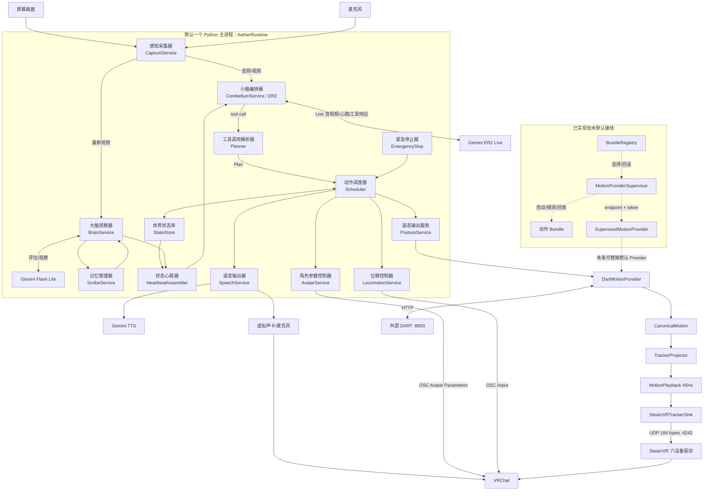

# Aether 开发者架构

> **文档定位**：这是面向新开发者的当前代码架构说明，不是产品宣传、部署手册或未来设计规格。内容以仓库当前实现为准；关键路径以反引号标出，代码名保留英文。若本文与代码冲突，以代码、测试和当前配置为准。
>
> **当前状态（2026-08-05）**：Aether 已完成供应商中立动作契约及默认 DART 适配、姿态输出链、主运行时合流和多轮真实运行修复。默认运行仍是一个 Python 主进程访问外部 DART HTTP 服务，并把姿态发给 SteamVR 驱动；`MotionProviderSupervisor`、`BundleRegistry`、`SupervisedMotionProvider` 已实现但没有接入默认 Runtime。2 小时 soak 按用户决定暂停。

## 1. 一句话模型

Aether 把 VRChat 角色分成三层：**大脑（Brain）负责观察、人格和建议台词；小脑（Cerebellum）负责 ER2 Live 会话与工具编排；核心控制层（Core）负责事实、计划、通道互斥和安全；输出服务负责把计划送到语音、OSC、SteamVR 等外部系统**。

目录拆分不等于进程拆分：除 DART、SteamVR 驱动和云端 API 外，默认组件都由 `AetherRuntime` 在同一个 Python 进程内装配。

## 2. 统一命名表

文档和沟通统一使用“中文职责名（English Code Name）”。Python 类名、文件名和公共接口不为中文名改名。

| 中文职责名（English Code Name） | 当前职责 |
|---|---|
| 运行时总装器（`AetherRuntime`） | 唯一组合根；创建服务、注册执行器与紧急停止钩子、启动后台循环、停止并清理资源。 |
| 感知采集器（`CaptureService`） | 屏幕 JPEG 与麦克风 PCM 采集；分别提供音频/视频异步流和最新画面。 |
| 大脑观察器（`BrainService`） | 用 Gemini Flash Lite 观察事实、对话、画面和记忆，产生 `BrainOutput`、建议台词、意图和记忆候选。 |
| 记忆管理器（`ScribeService`） | 记录文本/工具/结果块，批量标记重要性，压缩上下文并写入 SQLite。 |
| 小脑编排器（`CerebellumService`） | 维护 Gemini ER2 Live 连接，发送感知/心跳，接收转写和工具调用。 |
| 工具调用解析器（`Planner`） | `parse_tool_call` 只做协议翻译、参数规整、计划裁剪，不执行动作。 |
| 状态心跳器（`HeartbeatAssembler`） | 用事实快照和大脑观察拼装固定模板，并依据生成/说话/时间/变化闸门发送。 |
| 动作调度器（`Scheduler`） | 按 `seq` 推进计划，以 `Channel` 锁控制串并发，执行、超时、机械重试并汇总结果。 |
| 世界状态库（`StateStore`） | 在锁内原子发布不可变 `WorldFacts`；记录通道、活动计划、健康、结果、台词和停止状态。 |
| 紧急停止器（`EmergencyStop`） | 本地旁路并发执行停止钩子，释放计划/通道并登记 emergency 状态。 |
| 语音输出器（`SpeechService`） | 调 Gemini TTS，把音频送到配置的输出设备/虚拟麦克风。 |
| 角色参数控制器（`AvatarService`） | 用 OSC Avatar Parameters 触发预录动作和表情。只能传 `int/float/bool`。 |
| 位移控制器（`LocomotionService`） | 用 OSC `/input` 轴移动，带 watchdog 超时归零。 |
| 姿态输出服务（`PostureService`） | 外观门面：协调 Provider、投影、重采样/播放和 SteamVR Sink。 |
| 动作生成器端口（`MotionProviderPort`） | `start/close/health/status/capabilities/generate` 的供应商中立 Protocol。 |
| DART 动作生成器（`DartMotionProvider`） | 调 DART `/generate`、`/health`、`/status` HTTP API，并映射稳定错误。 |
| DART 动作翻译器（`DartTranslator`） | 将 DART `poses/trans/joints/framerate` 响应转为 `CanonicalMotion`。 |
| 标准动作数据（`CanonicalMotion`） | 固定 schema、帧率、22 关节、根位移、旋转、单位和坐标轴的中立动作格式。 |
| 追踪器投影器（`TrackerProjector`） | 只在这一边界知道 22 关节父子关系和六追踪器槽位，把标准动作转为 `PostureFrame`。 |
| 动作播放器（`MotionPlayback`） | 独立 45Hz keepalive 时钟；重采样、scope 裁剪、插值、播放、冻结、取消和站立姿态。 |
| SteamVR 追踪器输出器（`SteamVRTrackerSink`） | 打包并通过 UDP 发送 184-byte 六设备帧到 `bridge_port`。 |
| 动作生成器监督器（`MotionProviderSupervisor`） | sidecar 的启动、动态端口/token、健康探测、进程树回收和有限重启。 |
| 动作包注册表（`BundleRegistry`） | 持久化 manifest、stage/probe/activate/rollback 动作包版本。 |
| 托管动作生成器适配器（`SupervisedMotionProvider`） | 启动 Supervisor，拿 endpoint/token 构造真正 Provider，并转发统一端口。 |

## 3. 总架构与默认接线

图中**实线是当前默认接线**，**虚线是已实现但未默认接线的 sidecar 控制面**；虚线不是当前启动流程的一部分。



## 4. 当前真实进程模型

| 边界 | 当前事实 |
|---|---|
| `main-controller` | `python -m aether` 启动的单一 Python 进程；包含 `core`、`capture`、`brain`、`scribe`、`cerebellum`、`speech`、`avatar`、`locomotion`、`posture` 和异步后台任务。 |
| DART | 单独的外部 HTTP 服务；`config.yaml` 的 `dart.host/port/timeout_s` 默认是 `127.0.0.1:8900/60.0`。README 的示例通过 WSL2 启动它。 |
| SteamVR bridge/driver | 外部 SteamVR/OpenVR 驱动，监听 `posture.bridge_port` 默认 UDP `4242`；协议在 `contracts/frame.py` 与 C++ `driver.cpp` 对应。 |
| Gemini ER2/Flash/TTS | 外部云 API；Key 来自 `GEMINI_API_KEY`，不写配置文件。 |
| sidecar | Supervisor 具备启动独立 Provider 进程的实现，但默认 `AetherRuntime` 直接实例化 `DartMotionProvider`，不会自动读取 `config/motion_bundles`。 |

## 5. 完整数据流

### 5.1 感知、对话、观察和记忆

1. `CaptureService` 按 `capture.video_fps=1.0` 抓屏，压成 JPEG（最大宽度 `1024`、质量 `70`）；按 `input_sample_rate=16000`、`chunk_ms=100` 产生 PCM16 音频。队列满时丢最旧项，优先实时性。
2. `AetherRuntime._audio_pump` 把音频块送入 ER2；`_video_pump` 把视频帧送入 ER2。ER2 的转写回调进入 runtime 的 transcript，并由 `ScribeService.note("transcript", ...)` 记录。
3. `_brain_loop` 按 `brain.interval_s`（默认 60 秒）读取 `StateStore` 渲染事实、最近转写、`ScribeService.recall_recent()` 和 `CaptureService.latest_frame()`，调用 Flash Lite。输出解析为 `BrainOutput`，记忆候选写回 Scribe；`wake_er2` 可触发事件心跳。
4. `ScribeService` 将 `text/tool/result` 等块批量处理：模型 evaluator 可给出 `important/normal/worthless`；不可用时使用本地启发式。SQLite 路径是 `scribe.db_path`，默认 `data/memory.sqlite3`。
5. `_heartbeat_loop` 每 0.5 秒检查闸门。空闲目标间隔 2 秒，活动计划约 4 秒；用户讲话或 ER2 生成中不发送；无变化不重复发送。心跳由 `HeartbeatAssembler` 合并代码事实、大脑观察/建议和固定指令后送 ER2。

### 5.2 ER2 工具到执行输出

ER2 返回 function call 后，runtime 为每个调用创建 `_handle_call` 任务。`Planner.parse_tool_call` 将 `speak`、`expression`、`play_action`、`generate_motion`、`move`、`wait` 或 `execute_plan` 转成 `Plan`；非法工具/参数被拒绝，不在 Planner 执行。每个调用必须通过 `_respond` 回传 `function_response`，否则 ER2 会话可能卡住。

`Scheduler.submit` 接管 Plan：按 `seq` 遍历；可并行步骤只有在通道不相交时并发。短动作等待真实结果，`move`、`generate_motion` 或多步计划可先返回 `accepted`，结果通过后续 `[STATUS]` 心跳回流 ER2；所有结果写入 StateStore 并记录 Scribe。

- `SPEAK` → `SpeechService` → Gemini TTS → `speech.output_device`（默认 `MIXLINE`）→ 虚拟麦克风 → VRChat。
- `EXPRESSION` / `PLAY_ACTION` → `AvatarService` → `osc.host:port`（默认 `127.0.0.1:9000`）→ Avatar Parameters `ActionID` / `Expression`。
- `MOVE` → `LocomotionService` → OSC `/input`，超过 `locomotion.watchdog_s=5.0` 强制归零。
- `GENERATE_MOTION` → `PostureService` 动态姿态链（下一节）。预录全身动作会先 `posture.freeze()`，结束后 `resume()`，避免两个姿态源争抢。

## 6. 动态姿态动作：六层边界

默认链为：

```text
MotionRequest → MotionProvider → CanonicalMotion → TrackerProjector
→ MotionPlayback → SteamVRTrackerSink → UDP → SteamVR driver
```

1. **`MotionRequest`**：由 `PostureService.play` 生成唯一 `request_id`、prompt、`duration_s` 和 `scope`（`upper_body` 或 `full_body`）。
2. **Provider**：`MotionProviderPort.generate` 是唯一生成入口。默认 `DartMotionProvider` 把 prompt 规范化并附 repeat 次数，调用 DART `/generate`；HTTP/超时/无效响应统一为 `MotionProviderError`。
3. **`CanonicalMotion`**：`DartTranslator` 将专有 JSON 转换为 schema `1.0`、`humanoid-22`、米制、z-up、fps、frame_count、22 关节旋转、根位移（可选关节位置）。下游不应再解析 DART JSON。
4. **`TrackerProjector`**：验证骨架、单位、轴、帧数和每帧 22 关节；沿父子层级求世界旋转/位置，取头、双手、骨盆、双脚六个关节，转换 z-up 到驱动坐标，做地面偏移。
5. **`MotionPlayback`**：按 scope 保留上半身或全身，必要时从 Provider fps 重采样到 `posture.keepalive_fps=45`，段首插值；播放任务与 Provider 网络延迟分离。动作结束、取消或无动作时仍发送当前/站立帧。
6. **`SteamVRTrackerSink`**：序列化 `PostureFrame`，维护 sequence，通过 UDP `127.0.0.1:4242` 发出 184-byte 数据；驱动超过约 1 秒收不到包会把设备标记失联，因此 keepalive 不能停止。

### 不变量

- `request_id` 从请求贯穿 Provider/Translator/Canonical，不能丢失或伪造。
- Canonical 必须是 `humanoid-22`、`meters`、合法 `y/z` up-axis，帧数与 root/rotation 长度一致；每帧恰有 22 个旋转。
- Projector 是唯一拥有 tracker slot 顺序和坐标转换知识的层；Provider 不得直接输出驱动私有帧。
- 非 `full_body` 动作不得覆盖当前下半身；全身动作才占用下半身/移动通道。
- Provider 生成可慢，但 45Hz playback keepalive 必须独立持续；取消只清空队列并保持当前姿态，紧急停止才回站立姿态。
- `contracts/frame.py` 的 184-byte wire format、magic `0x54524144` 与驱动端必须同步。

## 7. 控制语义、错误和并发边界

### Plan、Channel、StateStore

`Plan` 是不可变步骤集合；`seq` 只表达顺序，`parallel=true` 只表示“尝试并发”。`Channel` 包括 `SPEECH`、`FACE`、`UPPER_BODY`、`LOWER_BODY`、`MOVEMENT`；`PlanStep.channels()` 对全身动态/预录动作扩展为全身集合。Scheduler 按枚举顺序获取 asyncio 锁避免死锁，同一时刻只运行一个 Plan；提交新计划会取消旧计划。

`StateStore` 是唯一权威事实写入点，模型不能直接写事实。所有变更在锁内发布新不可变 `WorldFacts`，读者看到一致版本。执行方登记通道占用和释放、活动计划、结果、服务健康、最后台词与 emergency 标记。

### EmergencyStop

本地关键词 `停下`、`别动`、`停止`、`stop`、`freeze` 不经过模型；也可由移动 watchdog、云端/桥故障或 CLI/ER2 `stop_all` 触发。runtime 注册 locomotion、speech、avatar、scheduler、posture 钩子；各钩子并发运行，每项 0.5 秒超时，最后释放所有通道并将 `emergency_stopped=true`。解除需要 `EmergencyStop.clear()`；停止不是普通 Plan。

### 重试与失败

单步默认超时 12 秒，也可用 step 的 `timeout` 覆盖。`MechanicalError`、`asyncio.TimeoutError`、`OSError` 只在本地重试一次；`SemanticError` 不重试并终止后续步骤。执行器的其他异常形成失败结果。DART Provider 将超时/网络不可用标为可重试，将认证、4xx、无效 JSON/格式区分为稳定错误；是否重试仍由上层执行语义决定，不把所有错误无限重试。

### 健康、生命周期和取消

启动顺序先输出（avatar、locomotion、speech、posture），再 scribe、brain、capture、ER2；随后创建 ER2 接收、音频、视频、心跳、大脑、健康任务。健康每 10 秒刷新 DART、posture、TTS、ER2、brain、OSC 并登记 StateStore。停止时先取消后台任务、等待它们结束、取消当前计划，再按服务顺序 stop；`PostureService` 会停止 playback、关闭 Provider 和 UDP sink。取消动作必须释放队列、锁和通道；`PostureService.play` 捕获取消并调用 playback cancel，不能遗留 45Hz 播放等待者。

## 8. 目录地图与依赖方向

```text
aether/
├── contracts/       facts.py frame.py motion.py observation.py perception.py plan.py
├── core/            facts_renderer.py heartbeat.py safety.py scheduler.py state_store.py
├── services/
│   ├── ports.py
│   ├── capture/ brain/ scribe/ cerebellum/
│   ├── speech/ avatar/ locomotion/
│   ├── posture/                 projector.py playback.py sink.py smpl_transform.py
│   └── motion/                  providers/dart/ supervised.py supervisor.py
├── infra/            config.py logging_setup.py
└── runtime/          agent.py cli.py smoke.py
config.yaml
config/motion_bundles/dart.example.json
```

依赖规则（`AGENTS.md` 的硬约束）：

```text
contracts/  ← 无依赖；公共数据契约
core/       ← 只依赖 contracts；不知道任何 service
services/   ← 只依赖 contracts + infra；服务之间不直接 import
runtime/    ← 唯一知道谁连接谁的组合根
```

服务间通信走 `StateStore` 或由 `runtime/agent.py` 接线；不要绕过边界直接引用另一个服务。特别注意 `contracts/frame.py` 与外部 C++ 驱动是刻意的协议耦合，修改必须两端同步。

## 9. 扩展指南

### 新增服务

1. 在 `aether/services/<name>/service.py` 实现职责，至少提供 `name`、`start`、`stop`、`health`。
2. 若有跨边界接口，在 `services/ports.py` 增加最小 Protocol；数据类型放 `contracts/`。
3. 在包的 `__init__.py` 导出；在 `infra/config.py` 增加带默认值的配置段。
4. 在 `runtime/agent.py` 实例化、注册 ActionKind 执行器和 `EmergencyStop` 钩子；不要让服务自行寻找其他服务。
5. 需要独立调试才加 `__main__.py`；日志模块名遵循 `aether.<module>`，必要时更新 `MODULE_COLORS`。

### 新增 Provider / Translator / Sink

- **Provider**：实现 `MotionProviderPort`，只接收 `MotionRequest`、返回 `CanonicalMotion`；外部 API 错误映射为 `MotionProviderError`，能力和健康真实反映后端；先用依赖注入传入 `AetherRuntime(motion_provider=...)` 验证，再决定是否成为默认。
- **Translator**：实现 `MotionTranslatorPort.translate(payload, request_id, provider_id)`；在边界验证 payload、22 关节、帧数、单位/轴，并生成完整 Canonical，不把专有格式泄漏到 posture/core。
- **Sink**：实现与 `PostureFrame` 对接的发送端口；若改变 wire format，必须同步驱动并更新 frame 测试。Sink 不应承担投影、生成或调度。
- **sidecar Provider**：准备 manifest（可参考 `config/motion_bundles/dart.example.json`），由 `MotionProviderSupervisor` 管生命周期，再由 `SupervisedMotionProvider` 暴露统一端口；目前不能假设仅放入目录就会默认启用。

## 10. 测试、命令和真实验证

### 常用命令

```powershell
# 安装
python -m venv .venv; .\.venv\Scripts\activate
pip install -r requirements.txt
pip install pytest pytest-asyncio

# 单元/集成测试
python -m pytest tests/ -q
python -m pytest tests/test_scheduler.py -v
python -m pytest tests/test_motion_provider.py tests/test_motion_supervisor.py -v

# 不依赖云端 API 的运行时冒烟（含真实 UDP 发包）
python -m aether.runtime.smoke

# 姿态服务调试（需要 DART 与 SteamVR bridge）
python -m aether.services.posture --prompt "wave hand"

# 主程序
python -m aether
```

单元测试应 mock 外部 API、网络、硬件和进程；Provider 测试验证 HTTP 错误映射/Translator，Supervisor 测试验证启动探测/重启/回收，姿态测试验证投影/播放/keepalive，Scheduler 测试验证顺序、通道、取消和重试。mock 只能替代边界，不能证明真实 DART 模型、真实麦克风、VRChat OSC 或 SteamVR 驱动可用。

真实验证按风险逐层进行：先 `smoke` 验证契约与 UDP，再启动 DART 检查 `/health`/`/status` 和 `PostureService` 45Hz，再接入云端 ER2/TTS/Brain，最后观察真实 VRChat 输出。历史真实运行已发现并修复 ER2 重连、DART 逗号/repeat、Brain 配额冷却等问题；2 小时 soak 当前按用户决定暂停，不应声称已完成 2 小时验收。

## 11. 当前完成度、接线和明确风险

### 已完成且默认接线

- `AetherRuntime` 主进程组合根、输入、ER2、Brain/Scribe、Heartbeat、Planner、Scheduler、EmergencyStop。
- 默认 `DartMotionProvider` → `DartTranslator` → `CanonicalMotion` → `TrackerProjector` → `MotionPlayback` → `SteamVRTrackerSink`。
- Speech/TTS 虚拟音频、Avatar/Locomotion OSC、状态快照、健康检查、取消和有限本地重试。
- 多轮真实短跑/联调及回归测试曾通过；具体当前结果应以本地命令重新运行的输出为准。

### 已实现但未默认接线

- `MotionProviderSupervisor`、`BundleRegistry`、`SupervisedMotionProvider` 与 manifest 解析、probe、activate、rollback、sidecar 重启/回收。
- 这些能力是可替换动作生成器的 sidecar 控制面，不代表默认运行时已使用它们。

### 明确未完成或风险

- Supervisor 尚未在 `AetherRuntime` 默认接线。
- Windows/发布 Bundle 尚未完成；DART Python/PyTorch 运行时、checkpoint、CLIP、SMPL-X 资产和许可证仍需发布核验。
- GPU backend 具有目标机差异；ONNX/WinML 不是前置条件，也不是当前 bundle 已提供的能力。
- 2 小时 soak 按用户决定暂停，不得写成已完成验收。
- `brain`/云服务实际可用性依赖 API Key、额度和外部服务；配置启用不等于每次观察都成功。`ScribeService` 的本地 SQLite 已可用，但检索目前是关键词匹配，不应描述为向量 RAG。

## 12. 常见误解与排查路径

| 误解/症状 | 正确认知与排查 |
|---|---|
| “OSC 可以直接控制骨骼” | 不能。预录/表情走 Avatar Parameters；骨骼姿态查 `posture`、UDP `4242`、`contracts/frame.py` 和 SteamVR driver。 |
| 姿态动作结束就停止发包 | 错。检查 `MotionPlayback` 的 keepalive task、`posture.keepalive_fps=45`、Sink sequence 和驱动是否持续收包。 |
| 放入 `config/motion_bundles` 就会启用新 Provider | 不会。默认组合根硬编码/注入 `DartMotionProvider`；Supervisor 仅实现未接线。检查 `runtime/agent.py` 的构造和依赖注入。 |
| DART 无响应就一直重试 | 先查 `dart.host/port/timeout_s`、DART `/health`/`/status`、日志和 `MotionProviderError`；Scheduler 机械错误最多本地重试一次。 |
| ER2 收到工具调用后卡住 | 检查 `AetherRuntime._respond` 是否回传 `function_response`，以及 Planner 是否拒绝了参数；再查 ER2 reconnect 日志。 |
| 大脑替角色直接执行动作 | Brain 只产生观察/建议；动作必须经过 ER2 tool call → Planner → Scheduler。检查 `brain.interval_s`、API Key、配额 cooldown 和 `BrainOutput`。 |
| 记忆消失 | 检查 `scribe.enabled`、`scribe.db_path`、batch flush、SQLite 文件及关键词 `recall`；上下文驱逐应先落盘，不等于向量检索。 |
| 计划步骤看似并行却等待 | 查看 `PlanStep.parallel` 与 `channels()`；同一 `Channel` 必须串行，`seq` 不能代替资源锁。 |
| 停止命令没有立刻停 | 紧急停止是本地旁路；检查关键词/`stop_all`、注册钩子、每项 0.5 秒超时、`StateStore.facts.emergency_stopped`，再调用 `clear()` 恢复。 |
| 服务目录就是独立进程 | 默认不是。先确认是否属于 `AetherRuntime` 主进程；只有 DART、SteamVR driver 和云 API 是当前外部边界。 |

排查优先顺序建议为：`python -m aether.runtime.smoke` → `StateStore`/`/status` 健康事实 → 相关服务日志 `logs/aether.log` → 外部端口/服务 → 最后才检查模型输出。这样能先排除契约、接线和硬件边界，而不是把所有故障归因于模型。
